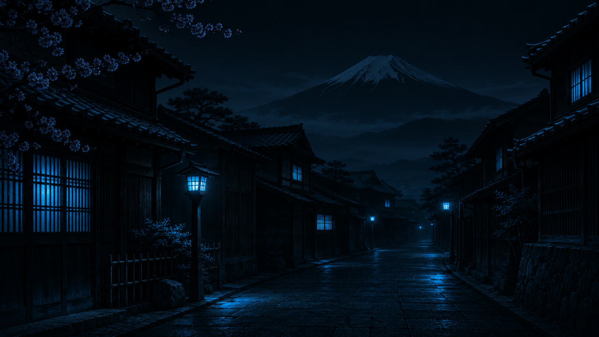
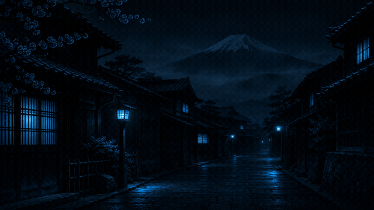

# Osaka Blue Glow

A very dark blue Omarchy theme inspired by Azure Glow, with icy-blue text,
subtle window glow, and a quiet Japanese town beneath a mountain at night.



### Animated preview



The preview is reduced in size and frame rate. The included wallpaper runs at
1920×1080 and 24 fps. [Download the full animated wallpaper](backgrounds/1-osaka-blue-night-animated.mp4).

## What you get

- Almost-black app backgrounds, with Azure Glow's blue and cyan palette.
- 2-pixel azure borders with a restrained 12-pixel outer glow at 25% opacity.
- The original still wallpaper and a 32-second animated version.
- Slow mountain mist and drifting clouds, two faintly flickering windows,
  and a distant street lamp that sputters at 6, 15, and 25 seconds.
  Its blue light on the street flickers in sync.

## Install the complete theme

Tested on **Omarchy 4.5.0 with Hyprland 0.56.2**. The custom window settings
use Hyprland's Lua configuration. Animated wallpaper playback requires an
Omarchy installation with video wallpaper support; otherwise choose the still.

Clone this repository into a working folder, then run the included installer:

```bash
git clone https://github.com/ruffryder007007/omarchy-osaka-blue-glow-theme.git
cd omarchy-osaka-blue-glow-theme
bash install.sh
```

This selects the animated wallpaper and installs the full window glow.
No sudo or extra rendering tools are needed. Existing theme installations
are backed up under `~/.local/state/omarchy/theme-backups/osaka-blue-glow/`
(or the equivalent location under `XDG_STATE_HOME`).

For the still wallpaper:

```bash
bash install.sh --still
```

To install the files without changing your active theme:

```bash
bash install.sh --no-apply
```

The installer copies an explicit set of theme files into
`~/.config/omarchy/themes/osaka-blue-glow/`. It omits Git metadata and development
files, so Omarchy treats the result as a local theme and loads `hyprland.lua`.
You can inspect the complete installer in [install.sh](install.sh).

### Standard Omarchy installer

```bash
omarchy theme install https://github.com/ruffryder007007/omarchy-osaka-blue-glow-theme
```

This installs the palette and wallpapers, but Omarchy filters out Lua from
Git-installed themes. **Use `bash install.sh` for the window glow too.**

## Wallpapers and updates

Switch between the two wallpapers:

```bash
omarchy theme bg next
```

Reapply the theme later:

```bash
omarchy theme set "Osaka Blue Glow"
```

Update from your original clone:

```bash
git pull --ff-only
bash install.sh
```

The installer selects the animated wallpaper unless `--still` is passed.
Omarchy may pause video when fullscreen, locked, or according to your playback
preferences. Uncover part of the desktop to see the animation.

### Restore a previous installation

Choose the backup printed by the installer. Move the current theme folder
aside, then move that backup to `~/.config/omarchy/themes/osaka-blue-glow/`
and reapply the theme. Backups are kept outside the theme picker directory.

## Rebuild the animation

The finished MP4 is included. To make changes, edit [tools/animate.cpp](tools/animate.cpp)
and render to a new output path:

```bash
bash tools/render.sh /tmp/osaka-blue-glow-custom.mp4
```

Rendering requires FFmpeg with libx264, ImageMagick 7, and g++.
The renderer preserves the artwork and adds periodic atmospheric effects.
The result is a silent 1920×1080 H.264 video at 24 fps.

## Credits and license

Created by **ruffryder007007**, with assistance from OpenAI Codex.
The color direction is inspired by [Azure Glow by Hydradevx](https://github.com/Hydradevx/omarchy-azure-glow-theme).
The wallpaper was generated for this theme; the animation renderer is included.
See [CREDITS.md](CREDITS.md) and [LICENSE](LICENSE).
